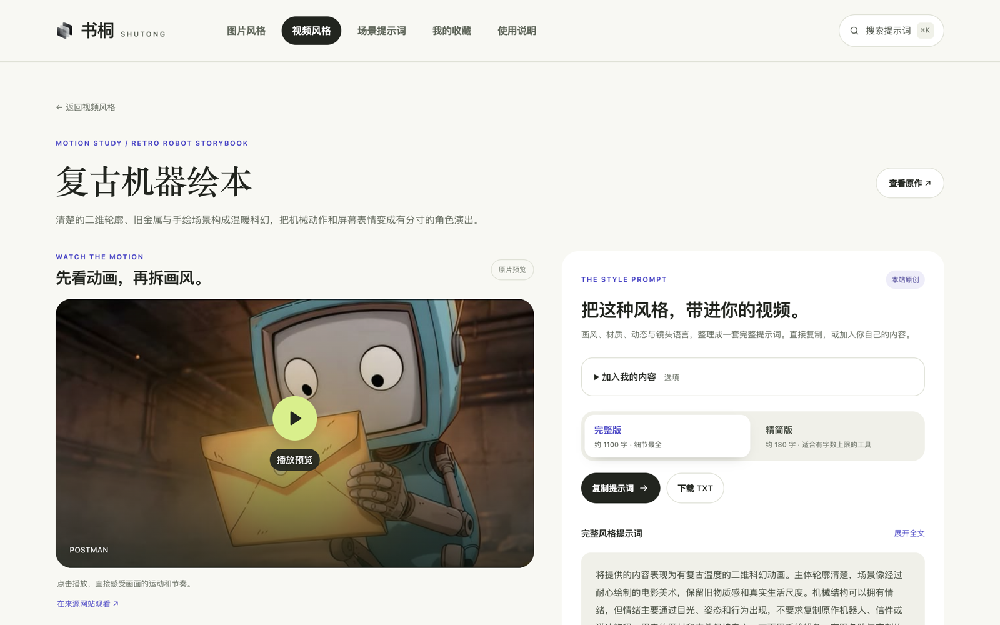

# 书桐 SHUTONG · 中文 AI 提示词网站

每一节中文在前、英文在后 · Every section is in Chinese first, then English.

> **写在前面**
>
> 我一直想要这样一个地方：打开它，就能找到真正好用的提示词；看到一张图，就知道它出自谁的手；复制过去，马上可以开始创作。
>
> 找了很久没有找到，于是我自己动手，一点一点搭起了这个网站。
>
> 可越往下做，我越明白：一个好的提示词网站，靠的从来不是这几行代码。它靠的是成百上千位创作者的心血，是那些被反复打磨的提示词，是那些一帧一帧做出来的作品。它们属于各自的作者，不属于我。我没有办法为每一件作品取得授权，也没有足够的精力和能力，把这个网站长久地运营下去。
>
> 所以我决定停在这里，把全部代码和整理思路留给愿意接着走下去的人。
>
> 如果你也曾想过做这样一个网站，希望它能成为你的起点。请带着对每一位创作者的尊重，去做一个比我好得多的版本。**我很期待看到它。**

> **A note before you begin**
>
> I always wanted a place like this: open it and find prompts that actually work; see an image and know whose hands made it; copy a prompt and start creating right away.
>
> I searched for a long time and never found one, so I built it myself, piece by piece.
>
> But the further I went, the clearer it became: a good prompt website was never about these few lines of code. It rests on the work of hundreds of creators: prompts polished again and again, works made frame by frame. They belong to their makers, not to me. I can't obtain permission for every one of them, and I don't have the time or the ability to keep this site running for the long haul.
>
> So I've decided to stop here, and leave all the code and the thinking behind it to whoever wants to carry it on.
>
> If you have ever dreamed of building a site like this, I hope it becomes your starting point. Please carry it forward with respect for every creator, and make something far better than mine. **I can't wait to see it.**

书桐是一个免登录、纯静态的中文 AI 提示词网站：66 种图片风格、40 种视频风格、48 个日常场景任务，每一条都标明出处，填一填、点一下复制，就能带去你常用的 AI 工具里开始创作。

Shutong is a free, login-free, fully static Chinese AI prompt website: 66 image styles, 40 video styles and 48 everyday task prompts, every one of them credited to its source. Fill in a few blanks, click copy, and take it to the AI tool you already use.

[](https://bryceyuuu.github.io/ai-prompt-website/)

<p align="center"><a href="https://bryceyuuu.github.io/ai-prompt-website/"><b>在线预览 · Live site</b></a> · <a href="#take-over">如果你想接手 · Carry it on</a> · <a href="#run-locally">本地运行 · Run locally</a> · <a href="THIRD_PARTY_NOTICES.md">素材来源与许可 · Credits &amp; licenses</a></p>

## 收录了什么 · What's inside

| 分类 · Category | 数量 · Count | 内容 · What you get |
|---|---|---|
| 图片风格 · Image styles | 66 | 照片转手办、针织、拼豆、拓印、手绘海报等，每条附来源案例图与作者署名<br>Photo-to-figurine, knitting, Perler beads, ink rubbing, hand-drawn posters and more, each with credited source examples |
| 视频风格 · Video styles | 40 | 从 AI 短片与动画作品中拆解材质、运镜和动作规律，附官方视频预览与参考画面<br>Materials, camera language and motion broken down from AI shorts and animation, with official previews and reference frames |
| 场景任务 · Task prompts | 48 | 写作、编程、分析、学习、商业、生活各 8 条，说明输入什么、交付什么<br>Eight each for writing, coding, analysis, learning, business and daily life, with clear inputs and deliverables |

整站只有 HTML / CSS / JavaScript，不需要后端、账号、API Key 或构建步骤，下载后直接打开 `index.html` 就能用，也可以部署到任何静态托管服务。

The whole site is plain HTML, CSS and JavaScript. No backend, account, API key or build step: open `index.html` and it works, or deploy it to any static host. It distributes prompts; it does not call AI models or host an image generator.

### 亮点 · Highlights

- **来源可追溯**：每条模板保留作者、原帖或仓库链接、许可和核验状态；参考图与本站实测严格区分，不冒充生成效果。<br>**Traceable sources**: every template keeps its author, original post or repository, license and review status. Reference images are never passed off as this site's own results.
- **视频风格两档提示词**：约 1000 字的完整版覆盖造型、材质、光照、动作和镜头连续性；约 200 字的精简版适合有字数上限的工具，一键切换。<br>**Two prompt lengths for video styles**: a ~1,000-character full version covering form, materials, lighting, motion and shot continuity, and a ~200-character concise version for tools with length limits. Switch with one click.
- **好找**：中英文搜索与别名、⌘K 全局搜索、按风格方向 / 用途 / 气质 / 来源组合筛选，视频按制作方式、画面媒介、题材气质、节奏动态分组。<br>**Easy to find**: Chinese and English search with aliases, ⌘K global search, combinable filters by style, use, mood and source; video styles grouped by production type, medium, mood and pace.
- **好用**：实时填写变量并预览，复制或导出 TXT / Markdown / JSON；收藏只存在本机浏览器，填写内容只在页面内存中，不上传。<br>**Easy to use**: fill in variables with a live preview, then copy or export as TXT, Markdown or JSON. Favorites stay in your browser; what you type stays in page memory and is never uploaded.
- **认真对待细节**：移动端布局、键盘操作、减少动态效果、加载失败兜底，配有回归测试、变异测试和真实浏览器走查。<br>**Care for the details**: mobile layout, keyboard support, reduced motion and graceful failure, backed by regression tests, mutation tests and real-browser checks.

[](https://bryceyuuu.github.io/ai-prompt-website/#/video/video-postman-animation)

<a id="take-over"></a>
## 如果你想接手 · If you want to carry it on

这些事我想做但没做完，也许正适合你：

These are things I wanted to do but never finished. Maybe they're for you:

- **实测效果**：视频详情页已经留好了「实测效果」区，目前每条都如实写着「尚未实测」。用真实模型跑一遍提示词、把结果和原作并排放上去，是让这个网站真正有用的关键一步（数据格式见 `assets/js/data-video.js` 中可选的 `tests` 字段）。<br>**Real test results**: each video detail page already has a "site tests" section, which honestly says "not tested yet". Running the prompts through real models and showing the results next to the originals is the step that would make this site truly useful (see the optional `tests` field in `assets/js/data-video.js`).
- **更多内容**：更多图片 / 视频风格和场景任务。`tools/curate/` 里有收录流水线和来源记录格式，新内容先核对来源与授权再上线。<br>**More content**: more image and video styles and task prompts. `tools/curate/` contains the intake pipeline and source-record format; check sources and permissions before anything goes live.
- **清理旧样式**：`assets/css/base.css`、`components.css`、`views.css` 是早期视觉层，仍有兼容代码，可以在视觉回归保护下精简。<br>**Clean up old styles**: `assets/css/base.css`, `components.css` and `views.css` are an earlier visual layer with compatibility code that could be slimmed down under visual-regression checks.
- **英文界面、社区投稿、真正的运营**：这些我都没有能力做，但很希望有人做。<br>**An English interface, community submissions, real operation**: all beyond what I can do, and all things I'd love to see someone do.

**fork 之前请注意素材授权**：代码按 MIT 开源，随便用；但第三方内容**不随代码授权**。Threads 作者的图片和提示词是作者单独授权本站转载的，视频参考画面是少量评论用图，版权归原作者。你在自己的网站上使用这些内容前，需要重新取得授权，或者替换成你自己的内容。详见 [THIRD_PARTY_NOTICES.md](THIRD_PARTY_NOTICES.md)。

**Before you fork, mind the content rights**: the code is MIT, use it freely. Third-party content is **not** covered. The Threads creators' images and prompts were licensed to this site individually, and the video reference frames are a small number of stills used for commentary; their copyright stays with the original creators. Before using any of it on your own site, get permission again or replace it with your own. See [THIRD_PARTY_NOTICES.md](THIRD_PARTY_NOTICES.md).

如果你做出了更好的版本，欢迎开个 Issue 告诉我，我很乐意在这里放上你的链接。

If you build a better version, open an Issue and tell me. I'd be glad to link to it here.

## 内容与来源 · Content and sources

### 视频风格 · Motion Studies

[浏览 40 种视频风格 · Browse all 40 video styles](https://bryceyuuu.github.io/ai-prompt-website/#/video)：从三维动画，到电影摄影、记忆梦境、定格动画、手绘与液态光学。

From 3D animation to cinematography, memory-like dreams, stop motion, hand-drawn work and liquid optics.

视频详情支持官方视频预览：点击卡片进入并静音播放，或在详情点击播放。原片、预告、幕后与演示分别标注；支持播放器音量、全屏和重试。未点击前不加载第三方播放器。播放依赖来源平台的网络和嵌入权限，始终保留原作链接。

Each detail page can play the official video: click a card to open it muted, or press play on the detail page. Films, trailers, behind-the-scenes and demos are labelled separately, with volume, fullscreen and retry. No third-party player loads until you click. Playback depends on the source platform's network and embedding rules; a link to the original is always kept.

2026-10-13 新增 **20 部 AI / 混合制作动画参考、40 张画面**，集中在绘本、纸浆人偶、手捏黏土、二维科幻、油画与角色动画。逐部核对动态片段与制作来源，按材质、角色表演、运镜和时间连续性拆解风格；新内容排在视频分类最前面。

On 2026-10-13, **20 AI / hybrid animation references with 40 frames** were added, focused on picture books, papier-mâché puppets, hand-made clay, 2D sci-fi, oil painting and character animation. Each was checked against its moving footage and production sources and broken down by material, performance, camera work and continuity.

| 新增风格 · New style | 参考作品 · Reference |
|---|---|
| 复古机器绘本 · Retro robot storybook | [POSTMAN](https://2026.jciaff.net/jp/film/detail/cat02-02.html) |
| 柔光云境童话 · Soft-light cloud fable | [Cloudling (2026) \| AI Animated Short Film](https://nikitafilipchenko.artstation.com/projects/q0L6qz) |
| 纸塑木偶小剧场 · Papier-mâché puppet theatre | [Little Mes](https://www.lucaslevitan.com/littlemes/) |
| 微缩童话奇境 · Miniature fairy-tale world | [CLOSET](https://capcut.creaite26.com/) |
| 表现主义情绪动画 · Expressionist emotion animation | [Dear Upstairs Neighbors · 官方制作拆解](https://blog.google/innovation-and-ai/models-and-research/google-deepmind/dear-upstairs-neighbors/) |
| 圆形英雄冒险 · Round-hero adventure | [Samurai Egg · AI 项目预告](https://www.youtube.com/watch?v=4bEZ09nh3XA) |
| 苔石偶动画 · Moss-and-stone puppet fable | [Until We Meet Again](https://www.juliewieland.com/) |
| 纸板木偶喜剧 · Cardboard puppet comedy | [TPU Training Day for I/O ’26（Timmy TPU）](https://nexusstudios.com/work/google-io-2026-tpu/) |
| 细绘幻彩漫画 · Finely drawn luminous anime | [This is Me](https://www.youtube.com/watch?v=zunXh_L_9Zw) |
| 午夜绘本漫游 · Midnight picture-book journey | [Pounamu](https://watch.runwayml.com/pounamu) |
| 木雕荒原寓言 · Woodcarved wasteland fable | [A Tree Once Grew Here](https://watch.runwayml.com/a-tree-once-grew-here) |
| 黏土霓光梦游 · Clay neon dreamscape | [WHY](https://www.hilarioabad.net/ai-video) |
| 复古外星木偶 · Retro alien puppet | [The Myth](https://watch.runwayml.com/the-myth) |
| 色域舞蹈变形 · Colour-field dance metamorphosis | [After Light](https://valleeduhamel.com/portfolio-item/afterlight/) |
| 线描异星生态 · Line-drawn alien ecology | [Migration](https://runway.com/customers/behind-the-scenes-of-migration-with-director-jeremy-higgins) |
| 哥特室内角色剧 · Gothic interior character drama | [Ausencia](https://www.contanimation.com/originals/) |
| 油画液态雕塑 · Oil-paint liquid sculpture | [Jacques — Absolve](https://www.thecvf-art.com/project.php?artist=paul-trillo&year=2024) |
| 拼贴科幻寓言 · Cut-out sci-fi fable | [Do The Evolution](https://ricardovillavicencio.com/type/animation/do-the-evolution/) |
| 荧光漫画拼贴 · Neon comic collage | [To Eat or Not To Eat](https://www.hyacinth.im/works/movie) |
| 冷雾动物黑色电影 · Cold-mist animal noir | [THE WELL](https://www.whatif.film/) |

每条包含两张来源可追溯的参考画面、逐帧点评，以及本站原创的两档视频风格提示词：约 1000 字的**完整版**覆盖造型、材质、光照、动作规律、镜头语言与时间连续性；约 200 字的**精简版**保留核心要素，适合有字数上限的工具。详情页可一键切换，复制和 TXT 跟随所选版本。可不填任何字段直接复制风格，也可选填自己的主体、场景与动作；不规定时长、画幅、剧情或固定分镜。排除词单独复制，主提示词支持展开阅读和下载 TXT。选填内容只存在页面内存中。

Every style has two traceable reference frames, frame-by-frame notes, and original prompts in two lengths: a ~1,000-character **full** version covering form, materials, lighting, motion, camera language and continuity, and a ~200-character **concise** version for tools with length limits. Copy and TXT export follow the version you pick. You can copy the style as-is or optionally add your own subject, scene and action; duration, aspect ratio, story and shot lists are left to you. Negative prompts are copied separately. Anything you type stays in page memory only.

参考涵盖《爱，死亡和机器人》7 集、Runway 的《Mars and Siv》《ONE》、Google Flow / Veo 官方示例，以及 Ono Trading 的生成式 AI 制作演示。《ONE》的环境动画与光学测试作为两个不同视觉方向分析。**这是编辑精选，不是热度排行榜**；AI 生成、混合制作、传统动画分别标注。实际视频截帧显示时间，官方剧照单独标注，不冒充本站生成效果。参考画面为少量风格评论用图，原权利人保留版权，不随代码按 MIT 授权；不分发原视频。原创提示词尚未做模型输出实测，也不是原片作者的制作提示词。

References include seven episodes of *Love, Death & Robots*, Runway's *Mars and Siv* and *ONE*, official Google Flow / Veo examples, and Ono Trading's generative-AI production demos. **This is an editor's selection, not a popularity ranking**; AI-generated, hybrid and traditional animation are labelled separately. Video frames show their timestamps and official stills are marked as such; none are presented as this site's output. The frames are a small number of stills for commentary, copyright stays with the rights holders, they are not MIT-licensed, and no original videos are distributed. The original prompts have not yet been tested against model output, and they are not the original creators' production prompts.

此前精选的 AI / 混合制作参考涵盖动画短片、电影摄影、奇幻生物与实验影像。每条保留作者、制作方式和可核实的入选依据，提示词不固定时长、画幅或剧情。

Earlier picks cover AI / hybrid animated shorts, cinematography, fantasy creatures and experimental film, each with its author, production method and a verifiable reason for inclusion.

| 风格 · Style | 参考作品 · Reference |
|---|---|
| 超现实日常纪录 · Surreal everyday documentary | [Air Head](https://www.shy-kids.com/film) |
| 有机微观电影 · Organic macro cinema | [ANCESTRA · 有机微观视觉与制作拆解](https://blog.google/innovation-and-ai/models-and-research/google-deepmind/ancestra-behind-the-scenes/) |
| 冷峻档案科幻 · Frosted archive sci-fi | [The Frost · 第一章](https://www.thefrost.ai/) |
| 奇幻生物拟纪录 · Fantasy creature mockumentary | [CRITTERZ · 2023 原版动画短片](https://www.critterz.tv/) |
| 记忆穿梭梦境 · Memory-hopping dream | [Washed Out — The Hardest Part](https://vimeo.com/941713443) |
| 复古档案超现实 · Retro archive surrealism | [Total Pixel Space](https://www.youtube.com/watch?v=zpAeygE4d1A) |

官方来源、每张图的素材类型、时间和校验值见[视频素材清单](tools/curate/sources/video-style-references.json)。

Official sources, the type, timestamp and checksum of every frame are in the [video source manifest](tools/curate/sources/video-style-references.json).

### Threads 公开图片提示词 · Image prompts from Threads

收录 [@lch1776244](https://www.threads.com/@lch1776244) 的 4 组公开帖子、作者回复中的提示词和 18 张示例图。每组一张风格卡，详情页可逐张放大。搜索 `Chloe_Lai`、`Threads` 或 `lch1776244` 即可找到。原帖与作者回复分开链接，未收录登录后才能访问的历史内容；本次不是全量账号归档。

4 public posts from [@lch1776244](https://www.threads.com/@lch1776244), with the prompts from the author's replies and 18 example images, one style card each. Search `Chloe_Lai`, `Threads` or `lch1776244`. Original posts and replies are linked separately; content behind login is not included, and this is not a full account archive.

经网站维护者确认转载授权收录，原作者保留权利；不将这些素材重新许可为 MIT / CC。具体范围见 [第三方内容说明](THIRD_PARTY_NOTICES.md#threads--chloe_lai)。

Included with republishing permission confirmed by the maintainer; the author keeps all rights and the material is not relicensed as MIT / CC. See the [third-party notice](THIRD_PARTY_NOTICES.md#threads--chloe_lai).

新增 [@inkacalinka](https://www.threads.com/@inkacalinka) 的 **10 组提示词与 61 张原始示例图**：极简纸感、黑白炭笔、抽象记忆、粉彩蜡笔、羊毛毡绘本、第二世界拼贴、珐琅旅行磁贴、彩色扁平插画、厚涂油画、手帐剪纸。搜索 `inkacalinka` 或 `michelle` 可找到。排除一组与“第二世界”用途近似的旧版黑线小人叙事；图片和原文校验去重，授权按账号分别记录。来源及筛选记录见 [素材清单](tools/curate/sources/threads-inkacalinka.json)。仅覆盖本次公开可读内容，不代表账号完整历史。

**10 prompts and 61 original examples** from [@inkacalinka](https://www.threads.com/@inkacalinka): minimal paper, black-and-white charcoal, abstract memory, pastel crayon, needle-felt picture book, "second world" collage, enamel travel magnets, flat colour illustration, impasto oil and journal cut-outs. Search `inkacalinka` or `michelle`. Images and texts were de-duplicated and permission is recorded per account; see the [source list](tools/curate/sources/threads-inkacalinka.json).

新增 [@blissful_nala](https://www.threads.com/@blissful_nala) 的 **10 组提示词与 27 张原始示例图**：角色三视图、马克笔生活涂鸦、复古邮票、印象派场景、色带厚涂微景、贝壳像素、梦核、层叠纸雕、超现实撞色和黏土贴纸。搜索 `blissful_nala`、`Lykke` 或对应中文风格即可找到。作者的长文附件和纸雕两段评论均已保存；毛毡帖子配错厚涂提示词的一组暂不收录。纸雕末句在原帖中未写完，页面已说明；梦核等关键词以参考照片的用法整理；透明贴纸的 JPEG 示例不代表具备透明通道。详见 [本次素材及筛选记录](tools/curate/sources/threads-blissful_nala.json)。首页轮播仍是 8 种精选效果，全量图片风格在分页列表中浏览。

**10 prompts and 27 original examples** from [@blissful_nala](https://www.threads.com/@blissful_nala): character turnaround, marker doodles, vintage stamps, impressionist scenes, ribbon impasto miniatures, shell pixel art, dreamcore, layered paper sculpture, surreal colour clash and clay stickers. Search `blissful_nala` or `Lykke`. One post whose impasto prompt didn't match its felt images was left out; an unfinished sentence in the original paper-sculpture prompt is noted on the page. See the [selection record](tools/curate/sources/threads-blissful_nala.json).

新增 [@smartaitools6](https://www.threads.com/@smartaitools6) 的 **10 条精选图片提示词、16 张对应案例图**：半脸字母肖像、虚拟换装、撕纸产品广告、职业蓝图、国家浮岛、手持插画卡、意面字母海报、卡通分身、杯内鱼眼广告与猫咪晚宴。包含 6 条图生图、4 条文生图，按任务显示正确的准备材料和使用方式。只收本次精选内容，不做账号全量归档；作者英文原文、来源与授权记录均保留。搜索 `smartaitools6`，或[直接浏览本批](https://bryceyuuu.github.io/ai-prompt-website/#/library?cat=image&source=threads%3Asmartaitools6)。详见[素材与筛选记录](tools/curate/sources/threads-smartaitools6.json)。

**10 selected prompts with 16 examples** from [@smartaitools6](https://www.threads.com/@smartaitools6): split-name portrait, virtual try-on, torn-paper product ad, profession blueprint, floating country island, hand-held art card, pasta-letter poster, cartoon alter ego, in-drink fisheye ad and a cat dinner portrait: six image-to-image and four text-to-image. The author's English originals and permission records are kept. Search `smartaitools6` or [browse this batch](https://bryceyuuu.github.io/ai-prompt-website/#/library?cat=image&source=threads%3Asmartaitools6); see the [selection record](tools/curate/sources/threads-smartaitools6.json).

新增 [@emersonigpost](https://www.threads.com/@emersonigpost) 的 **13 组提示词、118 张原尺寸案例图**：极细线条情绪海报、几何故事、氛围像素、拼布手缝、古器物拓印、日式便当、混合媒材拼贴、白色概念模型、拼豆色卡、柔焦光影、双专色孔版印刷、复古旅行票券与越界色场。搜索 `emersonigpost`、`Emerson` 或具体风格即可找到。本次核对公开显示的 2026-09-11 至 2026-10-05 帖子，从 21 份作者原文中去重筛选 13 组；另有 2 组未找到完整公开提示词，暂不收录。英文与繁体中文原文保留，作者互动引言与实际提示词分开；本次授权由维护者单独确认。详见 [素材、原文及筛选记录](tools/curate/sources/threads-emersonigpost.json)。这是本次公开内容快照，不是账号完整历史归档。

**13 prompts with 118 full-size examples** from [@emersonigpost](https://www.threads.com/@emersonigpost): fine-line emotion posters, geometric stories, atmospheric pixels, patchwork stitching, artifact ink rubbing, konbini bento, mixed-media collage, white concept models, Perler-bead colour cards, soft-light memories, two-ink Risograph, vintage travel tickets and break-frame colour fields. Selected from 21 public posts dated 2026-09-11 to 2026-10-05; English and Traditional Chinese originals are kept, and permission was confirmed separately. See the [source and selection record](tools/curate/sources/threads-emersonigpost.json).

新增 [@jenniferzhao08](https://www.threads.com/@jenniferzhao08) 的 **「照片转韩式手绘问候海报」1 条提示词与 4 张案例图**，位于首页图片列表首条。保留[作者回复中的完整提示词](https://www.threads.com/@jenniferzhao08/post/DeYRYGulLho)与[原帖](https://www.threads.com/@jenniferzhao08/post/DeYRXkrFFi_)，图片为作者示例，非本站模型实测。搜索 `jenniferzhao08` 或「韩式手绘」即可找到。维护者于 2026-10-12 单独确认该账号的图片、完整提示词、公开网站与 GitHub 转载授权；详见[素材清单](tools/curate/sources/threads-jenniferzhao08.json)及[第三方说明](THIRD_PARTY_NOTICES.md#threads--jenniferzhao08)。

**1 prompt with 4 examples** from [@jenniferzhao08](https://www.threads.com/@jenniferzhao08), "photo to Korean hand-drawn greeting poster", first in the homepage image list. The [full prompt from the author's reply](https://www.threads.com/@jenniferzhao08/post/DeYRYGulLho) and the [original post](https://www.threads.com/@jenniferzhao08/post/DeYRXkrFFi_) are linked; the images are the author's own examples. Permission for the images, prompt, public website and GitHub was confirmed on 2026-10-12; see the [source list](tools/curate/sources/threads-jenniferzhao08.json) and the [third-party notice](THIRD_PARTY_NOTICES.md#threads--jenniferzhao08).

### 当前内容 · Current catalogue

- **66 个图片创作模板**：18 种原有图片转换，以及 6 个 Threads 来源账号的 48 组经授权案例。涵盖创意物件、材质工艺、插画绘画、平面拼贴、微缩场景与摄影光影，包括虚拟换装、产品广告、字母肖像、职业蓝图、拼豆、刺绣、拓印等具体创作方向。<br>**66 image templates**: 18 original image transformations plus 48 licensed sets from 6 Threads creators, across creative objects, materials and crafts, illustration, graphic collage, miniature scenes and photography.
- **40 个视频风格**：独立画风研究分类，点击卡片直接预览官方视频，附80张来源参考画面、动态风格解析与完整原创风格提示词。<br>**40 video styles**: a separate style-study section with official previews, 80 sourced reference frames, motion analysis and original prompts.
- **48 个文字任务**：写作、编程、分析、学习、商业、生活各 8 条。提供输入项、处理步骤、交付格式和信息不足时的处理方式。<br>**48 text tasks**: eight each for writing, coding, analysis, learning, business and daily life, with inputs, steps, output format and what to do when information is missing.
- 图片可按六个风格方向浏览，再组合用途、气质与内容来源筛选；支持空格分隔的多词搜索，当前条件可逐项移除。<br>Browse images by six style directions and combine filters by use, mood and source; multi-word search, with each active filter removable.
- 多图案例支持左右箭头、手势滑动、横向缩略图及大图连续浏览，图片序号与署名同步更新。<br>Multi-image examples support arrows, swipe, thumbnails and a full-size viewer, with numbering and credits kept in sync.
- 首页、分类及收藏支持每页 12 条的页码导航；翻页保留筛选与排序，详情返回保留页码。<br>12-per-page pagination on the homepage, categories and favorites; filters and sort order survive paging and returning from a detail page.
- 实时填写与预览、当前浏览器收藏、来源图全屏预览、自动/手动轮播、复制与 Markdown / JSON 导出、移动端布局、键盘导航和减少动态效果支持。<br>Live fill-in preview, in-browser favorites, full-screen source images, auto/manual carousel, copy and Markdown / JSON export, mobile layout, keyboard navigation and reduced motion.

图片模板使用方式：在支持图片编辑的 AI 工具中上传原图，再粘贴模板。本站提供提示词，不直接调用模型生成图片。文字模板需要填写输入材料后再提交给 AI 工具。

How to use image templates: upload your photo to an AI tool that supports image editing, then paste the prompt. This site provides prompts only; it does not generate images. For text tasks, fill in your material first, then send it to your AI tool.

**效果说明：** 本站做了编辑筛选和功能测试，但尚未逐条运行验证模型输出。风格卡图片为上游公开案例，不是本站中文改编版的实测结果。首页材质专题使用原创 AI 展示图并明确标注为视觉示意。GitHub 星数是仓库级历史快照，不是单条模板热度或质量评分。

**About results:** the content is editorially reviewed and the site is functionally tested, but model output has not been verified prompt by prompt. Style-card images are the sources' public examples, not results of this site's Chinese adaptations. The homepage materials feature uses an original AI image clearly labelled as illustrative. GitHub star counts are repository-level snapshots, not ratings of individual templates.

## 从发现到使用 · From discovery to use

1. 首页依次是图片风格精选与全部图片、视频风格精选、六类场景任务入口；也可从顶部导航直接进入「视频风格」或「场景提示词」。<br>The homepage shows featured and all image styles, a video-style selection and six task categories; the top navigation goes straight to video styles or task prompts.
2. 打开模板，在「填入你的需求」中填写材料，提示词实时组装。<br>Open a template and fill in your material; the prompt assembles live.
3. 复制或下载填写后的提示词，到你的 AI 工具中运行；图片任务还要上传原图。<br>Copy or download the filled-in prompt and run it in your AI tool; for image tasks, upload your photo too.
4. 点击书签保存在「我的收藏」。仅收藏 ID 存入本地浏览器；材料只在页面内存中，刷新即清空，不发送到服务器。<br>Bookmark templates to "My favorites". Only template IDs are stored in your browser; your material stays in page memory, is cleared on refresh, and is never sent to a server.

视觉规范见 [DESIGN.md](DESIGN.md)，变更记录见 [CHANGELOG.md](CHANGELOG.md)。

Design rules: [DESIGN.md](DESIGN.md). Change log: [CHANGELOG.md](CHANGELOG.md) (both in Chinese).

## 按任务查找提示词 · Find a prompt by task

搜索日常说法或英文任务名，都可以定位模板：

Search everyday Chinese phrases or English task names:

| 场景 | 常用搜索词 |
|---|---|
| 图片风格转换 / Image-to-image | 照片转手办、拼豆、刺绣、拓印、复古旅行票券、微缩模型、style transfer、pixel art、Perler Bead、Risograph |
| 视频画风 / Video styles | AI 动画、绘本、黏土、纸浆人偶、二维漫画、油画、科幻、爱死机、Sora、Veo、Runway、AI animation、cinematic |
| 写作与翻译 / Writing & translation | 文案润色、商务邮件、中英翻译、语法纠错、长文总结、proofreading、email reply |
| 编程开发 / Coding | 代码审查、找 bug、日志分析、命令行、Git 提交说明、code review、debugging、system design |
| 分析与决策 / Analysis | 事实核查、论文精读、方案对比、数据提取、fact checking、decision matrix、text to CSV |
| 学习教育 / Learning | 闪卡、Anki 卡片、练习题、课堂笔记、学习计划、flashcards、quiz generator |
| 商业职场 / Business | PRD、产品需求文档、用户反馈、销售复盘、会议纪要、meeting minutes、action items |
| 生活日常 / Everyday tasks | 菜谱整理、服务条款、年度总结、购物对比、recipe extraction、buying guide |

<a id="run-locally"></a>
## 本地预览 · Run locally

下载仓库后直接打开 `index.html`。也可以运行：

Download the repository and open `index.html`, or run:

```bash
python3 -m http.server 8000
```

然后访问 <http://localhost:8000>。可将静态文件部署到支持静态站点的托管服务。

Then visit <http://localhost:8000>. The files can be deployed to any static hosting service.

## 开发与检查 · Development and checks

需要 Node.js 22.22.2+（22.x）、24.15.0+（24.x）或 26+；重新生成内容时还需要 Python 3。Node 依赖仅用于开发测试，不影响直接打开页面。

Requires Node.js 22.22.2+ (22.x), 24.15.0+ (24.x) or 26+, plus Python 3 to regenerate content. Node dependencies are only for development and tests; the site itself runs without them.

```bash
npm ci
npm test
npm run test:mutations
```

浏览器走查为可选检查，需要本机 Chrome。每次启动都使用临时配置目录，结束后自动清理：

Real-browser checks are optional and need a local Chrome. Each launch uses a throwaway profile directory that is cleaned up afterwards:

```bash
# macOS 使用标准 Chrome 安装路径；Linux 默认 google-chrome。自定义位置时设置 CHROME_BIN。
# macOS uses the standard Chrome path; Linux defaults to google-chrome. Set CHROME_BIN for a custom location.
npm run test:browser
```

`./tools/accept.sh` 执行基础检查；`./tools/accept.sh full` 增加变异与浏览器检查。

`./tools/accept.sh` runs the basic checks; `./tools/accept.sh full` adds mutation and browser checks.

## 内容维护 · Maintaining content

```text
index.html                     页面入口
assets/js/app.js               路由、交互和渲染
assets/js/data.js              图片与任务分类、数据组装
assets/js/data-video.js        手工编辑的 40 种视频风格
assets/js/video.js             视频风格列表、站内播放、分析、提示词和大图交互
assets/img/video/              80 张风格评论用参考画面（版权保留）
assets/js/data-curated.js      生成的 114 条内容
assets/css/                   页面样式
assets/img/curated/            来源案例图
schema/                       数据规范与校验
tools/curate/text-specs.json  文字任务编辑清单
tools/curate/keywords.json    每条模板的中英文搜索别名
tools/curate/build.py         图片模板与离线生成器
tools/curate/sources/         来源快照、署名与许可证
```

修改 `text-specs.json` 或 `build.py` 中的图片清单，然后执行：

Edit `text-specs.json` or the image list in `build.py`, then run:

```bash
npm run build:catalog
npm test
```

浏览分类与来源筛选的维护方式见 [目录浏览层](docs/catalog-browsing.md)。请勿直接修改生成的 `data-curated.js`。提交新内容时请给出明确的输入、可验收的产物、出处与许可；未经验证的效果不得标为实测。

Browsing categories and source filters are documented in [docs/catalog-browsing.md](docs/catalog-browsing.md). Don't edit the generated `data-curated.js` by hand. New content needs clear inputs, a verifiable deliverable, its source and its license; never label untested results as tested.

## 开源协议与致谢 · License and credits

项目原创代码使用 [MIT License](LICENSE)。**该许可证不覆盖第三方内容**：

The project's original code is under the [MIT License](LICENSE). **That license does not cover third-party content**:

- 视频参考画面用于少量视觉评论，保留原权利人版权，不纳入 MIT；不分发原视频，提示词为本站原创练习。<br>Video reference frames are a small number of stills for commentary; copyright stays with the rights holders and they are not MIT-licensed. No original videos are distributed; the prompts are original.
- 文字任务改编自 [danielmiessler/fabric](https://github.com/danielmiessler/fabric)，遵守上游 MIT，保留完整版权声明。<br>Text tasks are adapted from [danielmiessler/fabric](https://github.com/danielmiessler/fabric) under its MIT license, with the full copyright notice kept.
- Threads 图片与提示词按维护者确认的转载授权收录，保留作者与原帖链接；不授予第三方自由转载权。<br>Threads images and prompts are included under republishing permission confirmed by the maintainer, with author and post links kept; no right to republish is granted to anyone else.
- 原有图片与图片模板的来源是 [jamez-bondos/awesome-gpt4o-images](https://github.com/jamez-bondos/awesome-gpt4o-images)。所选案例按各自署名文件标注为 CC BY 4.0；中文模板经过改编，案例图片保持原文件。<br>The original image templates come from [jamez-bondos/awesome-gpt4o-images](https://github.com/jamez-bondos/awesome-gpt4o-images); the selected examples are CC BY 4.0 per their attribution files. The Chinese templates are adapted; the images are unchanged.

逐项作者、来源、许可及使用范围见 [THIRD_PARTY_NOTICES.md](THIRD_PARTY_NOTICES.md)。转载或修改内容时请保留对应署名、许可链接和改动说明。

Per-item authors, sources, licenses and scope are listed in [THIRD_PARTY_NOTICES.md](THIRD_PARTY_NOTICES.md). Keep the attribution, license link and a note of changes when you reuse or modify content.
